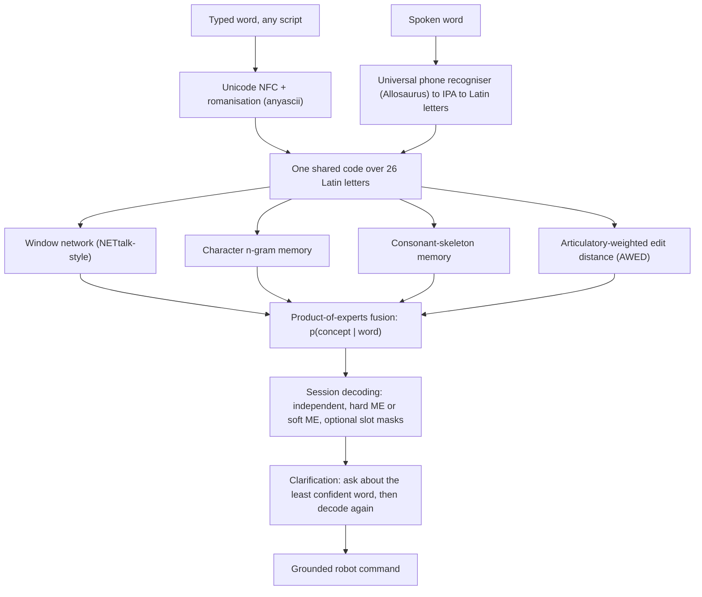

# PolyCMD: a multilingual lexicon for grounding robot command words in unseen languages and scripts

Repository: [https://github.com/hasib1233333/PolyCMD-A-Reproducible-Multilingual](https://github.com/hasib1233333/PolyCMD-A-Reproducible-Multilingual)

This repository contains the lexicons, code and result files for the paper

> Md Hasibuzzaman, Gene Eu Jan and Chan-Yun Yang. *PolyCMD: A Reproducible Multilingual Lexicon for Grounding Robot Command Words in Unseen Languages and Scripts.* Submitted to *Language Resources and Evaluation*.

Contact: Md Hasibuzzaman (corresponding author), hsbuzzaman@gmail.com

---

## Contents

1. [Overview](#1-overview)
2. [The resources](#2-the-resources)
3. [How the system works](#3-how-the-system-works)
4. [Repository layout](#4-repository-layout)
5. [Installation](#5-installation)
6. [Quick check for reviewers](#6-quick-check-for-reviewers)
7. [Reproducing every table and figure](#7-reproducing-every-table-and-figure)
8. [Expected key numbers](#8-expected-key-numbers)
9. [Evaluation protocol](#9-evaluation-protocol)
10. [File formats](#10-file-formats)
11. [Runtime](#11-runtime)
12. [Troubleshooting](#12-troubleshooting)
13. [Data sources and licences](#13-data-sources-and-licences)
14. [Citation](#14-citation)

---

## 1. Overview

A service robot often has to understand short parameter words in a command, such as *three*, *metre*, *Monday* or *March*, in a language that was not part of its training data, and sometimes in a writing system it has never seen. This repository provides:

- **PolyCMD**: 1,813 command words for 43 concepts in 44 languages, 16 genealogical groups and 13 scripts.
- **PolyCMD-U**: 424 words in 11 languages that are not in the pretraining data of LaBSE, XLM-R or multilingual-MPNet.
- **PolyNET**: a small reference model (34,507 parameters) and all baselines used in the paper.
- **Every experiment**, with the raw per-fold scores, so that each table and figure can be regenerated and checked.

No word in either lexicon was typed by hand. Both are generated from the Unicode Common Locale Data Repository (CLDR) by the scripts in this repository and can be rebuilt exactly.

## 2. The resources

| | PolyCMD | PolyCMD-U |
|---|---|---|
| Words | 1,813 | 424 |
| Languages | 44 | 11 |
| Genealogical groups | 16 | 9 |
| Scripts | 13 | 4 (two of them, Cherokee and Chakma, absent from PolyCMD) |
| Concepts | 43 | 43 |
| Role | 8 development + 36 test languages | test only |

**Concepts (43):** numbers 1 to 10; units of length (millimetre, centimetre, metre, kilometre), time (second, minute, hour, day, week), angle (degree, radian), mass (gram, kilogram) and volume (litre); the seven weekdays; the twelve months.

**PolyCMD-U languages:** Faroese, Northern Sami, Kalaallisut, Quechua, Venetian, Akan, Ewe, Fula, Cherokee, Chakma and Northern Luri.

**Distractors:** 1,259 single-word country names and 848 command-like unit names (for example *inch*, *mile*, *millisecond*), used to test the rejection of non-command words.

**How the lexicons are built** (`text/build_lexicon.py`, `text/build_uncovered.py`):

1. Number words come from `num2words`, or from CLDR rule-based number spell-out (RBNF) where `num2words` has no data.
2. Unit names are CLDR long unit names; weekdays and months are CLDR stand-alone calendar names, read with Babel.
3. An entry is removed when CLDR falls back to the root locale, when a calendar name is numeric (for example Japanese months written with numerals), when only an abbreviation exists, or when one surface form names two concepts in the same language.

`text/audit_lexicon.py` repeats the construction, records why each candidate was dropped, and confirms that the result is identical to the released `lexicon.json` (MD5 `c7e3034679b6e992fd6c003c8f12a11d`).

## 3. How the system works



### Step 1: script bridge
`text/models.py`, function `romanize`. Every word is normalised to Unicode NFC and romanised with `anyascii`, so that Russian *метр*, Czech *metr* and Japanese *メートル* all become Latin strings.

### Step 2: articulatory letter code
`text/models.py`, `FEAT` and `phon_vec`. Each letter $a$ is encoded as

$$\boldsymbol\phi(a) = [\mathbf e_a;\ \mathbf g_a] \in \{0,1\}^{26+19},$$

a one-hot identity $\mathbf e_a$ plus 19 coarse articulatory features $\mathbf g_a$ (place, manner, voicing, vowel height and backness, vowel and boundary flags). Similar sounds such as *p* and *b* therefore get similar codes.

### Step 3: window network
`text/models.py`, class `WindowNet`. As in NETtalk, a seven-letter window slides over the padded word. At position $t$ the input is $\mathbf x_t = [\boldsymbol\phi(a_{t-3});\dots;\boldsymbol\phi(a_{t+3})]$ and

$$\mathbf h_t=\sigma(W_1\mathbf x_t+\mathbf b_1),\qquad \mathbf z_t=W_2\mathbf h_t+\mathbf b_2,\qquad p_{\mathrm{net}}(c\mid w)=\operatorname{softmax}_c\Big(\frac1L\sum_{t=1}^{L}\mathbf z_t\Big).$$

With $H=96$ hidden units the network has 34,507 parameters. It is trained with cross-entropy and Adam (learning rate $3\times10^{-3}$, 60 epochs, weight decay $10^{-4}$), with letter-level augmentation (deletion, substitution or insertion with a total probability of 0.1).

### Step 4: similarity memories
`text/models.py`, classes `NgramKNN`, `EditNN` and `AWEDNN`, and function `skeleton`. The training words are stored, and a concept is scored by its best exemplar:

$$s_v(w,c)=\max_{(u,c)\in\mathcal M}\kappa_v\big(\rho(w),\rho(u)\big).$$

The three views are (i) the cosine similarity of character 1-3-gram counts, (ii) the same on the consonant skeleton, and (iii) an edit similarity whose costs follow articulatory features (vowel insertion 0.5, consonant insertion 1, vowel-vowel substitution 0.3, consonant-consonant substitution $1-0.8\,|\mathbf f_a\cap\mathbf f_b|/3$).

### Step 5: fusion
`text/models.py`, class `PolyNET2`. The four views are combined log-linearly:

$$\log p(c\mid w)=\lambda_0\log p_{\mathrm{net}}(c\mid w)+\sum_{v=1}^{3}\frac{\lambda_v}{T}\,s_v(w,c)-\log Z(w),$$

with $\boldsymbol\lambda=(1,1,0.5,1)$ and $T=0.02$. Both were chosen by grid search on the 8 development languages only (`text/tune.py`; the result is in `text/results/tuned.json`).

### Step 6: session decoding
`text/models.py`, function `mutual_exclusivity`; `text/revision_analyze.py`, function `soft_me`. The distinct words $\mathcal S=\{w_1,\dots,w_k\}$ of one session can be decoded jointly. Under hard mutual exclusivity (ME), two different words may not take the same concept:

$$\pi^\star=\arg\max_{\pi\ \text{injective}}\ \sum_{i=1}^{k}\log p\big(\pi(i)\mid w_i\big).$$

This is a rectangular assignment problem, solved exactly with `scipy.optimize.linear_sum_assignment` in $O(k^2C)$ time. Soft ME allows a concept to be used again at a penalty $\gamma$ for each extra use ($\gamma=0.5$, chosen on the development languages). A parser that knows which slot a word fills (number, unit, weekday or month) can restrict the word to that category (slot masks).

### Step 7: clarification
`text/clarify_analyze.py`, functions `trace` and `run_session`. While the least confident unconfirmed word has a confidence below $\tau$, the robot asks the user about that word, fixes the answer and decodes the session again. $\tau$ is chosen on the development languages. In simulated sessions this raises the share of fully correct sessions from 40% to 92%, with 2.7 questions per session on average.

### Step 8: speech path
`speech/recognize.py`, `speech/phon.py` and `speech/ground.py`. Audio is converted to IPA by the Allosaurus universal phone recogniser and mapped onto the same 26 letters (`ipa2lat`). The memories store every training word both as spelled and as pronounced by eSpeak NG, and the fusion weights are re-tuned on synthetic speech of the development languages (`speech/tune_speech.py`).

## 4. Repository layout

```
.
├── README.md
├── text/
│   ├── build_lexicon.py         builds PolyCMD (lexicon.json, distractors.json)
│   ├── build_uncovered.py       builds PolyCMD-U (lexicon_uncovered.json)
│   ├── build_distractors2.py    command-like unit-name distractors
│   ├── common.py                shared data loading and splits
│   ├── models.py                romanisation, letter code, memories, window network, PolyNET, ME
│   ├── tune.py                  fusion weights on the development languages
│   ├── run_all.py               main leave-one-language-out study
│   ├── revision_run.py          3 seeds, baselines, script holdout
│   ├── revision_analyze.py      controlled analyses, calibration, exclusivity tests
│   ├── revision2_run.py         family holdout and PolyCMD-U
│   ├── revision2_analyze.py     tables for the family holdout and PolyCMD-U
│   ├── clarify_analyze.py       realistic sessions, clarification, closed-loop simulation
│   ├── threshold_analyze.py     rejection thresholds across languages
│   ├── audit_lexicon.py         benchmark audit
│   ├── pretrained_analyze.py    pretrained encoder comparison
│   ├── figures.py, top10.py, langsim.py, sim.py, simfig.py, open_energy.py,
│   │   make_examples.py, make_numbers.py      figures and numbers
│   ├── verify_reproduction.py   end-to-end reproduction check
│   ├── requirements.txt
│   ├── lexicon.json, lexicon_uncovered.json, distractors.json, distractors_units.json
│   ├── rev/  rev2/              per-fold scores of every method
│   ├── results/                 numbers behind every table and figure (JSON)
│   ├── pretrained/              pretrained encoder outputs
│   ├── data/                    CLDR RBNF rules for Urdu
│   └── paper/                   generated tables (tab_*.tex), figures (fig_*.pdf), numbers.tex
├── speech/
│   ├── espeak.py, recognize.py, phon.py, ground.py, tune_speech.py,
│   │   analyze.py, text_g2p.py, analyze_g2p.py
│   ├── cache/g2p.json           eSpeak NG pronunciations of every lexicon word
│   ├── results_speech.json      numbers behind the speech tables and figures
│   └── results_g2p.json         numbers behind the spelling-vs-pronunciation comparison
├── pretrained_kit/
│   ├── pretrained_baseline.py   encoder baselines under the same protocol
│   └── pretrained_embed.py      raw embeddings for all protocols
└── manuscript_sources/          LaTeX sources of the paper
```

**File sizes.** The whole release is about 11 MB and no single file is larger than 5 MB, so every file stays far below GitHub's limits and the repository is uploaded as one archive without splitting. The largest folders are `text/rev/` (about 6 MB, 44 files of about 0.1 MB each) and `text/rev2/` (32 files).

**Public datasets are not included.** The audio of AudioMNIST and the Free Spoken Digit Dataset, the CLDR data and the pretrained encoders are all publicly available from their original sources (Section 13), so they are not copied here. Every number in the paper can still be checked: the text study runs entirely from the files in this repository, and the speech numbers are stored in `speech/results_speech.json`. To recompute the speech scores from audio, download the two corpora as described in Section 7.2.

## 5. Installation

Python 3.10 or newer (tested with Python 3.13). The exact versions used for the paper are pinned in `text/requirements.txt`.

```bash
git clone https://github.com/hasib1233333/PolyCMD-A-Reproducible-Multilingual.git
cd PolyCMD-A-Reproducible-Multilingual
pip install -r text/requirements.txt
```

The text study needs NumPy, SciPy, scikit-learn, rapidfuzz, numba, Babel, anyascii, num2words, unicode-rbnf and matplotlib. PyTorch, Allosaurus and soundfile are needed only to recompute the speech results from audio (Section 7.2).

**The Babel version matters.** The lexicon is generated from the CLDR data that ships with Babel. Use `babel==2.18.0` to reproduce `lexicon.json` byte for byte.

## 6. Quick check for reviewers

One command checks the whole chain (about 2 minutes on one CPU core):

```bash
cd text
python verify_reproduction.py
```

It runs four checks:

1. the MD5 checksum of `lexicon.json`;
2. a full rebuild of the lexicon from CLDR and a comparison with the released file;
3. retraining of one held-out language (Bengali) from scratch and a comparison with the stored scores;
4. regeneration of the tables of the controlled analyses, the pretrained encoder comparison, the family holdout, PolyCMD-U, the session and clarification study, the rejection thresholds and the benchmark audit from the stored scores, with a byte-by-byte comparison with `text/paper/tab_*.tex`.

The last line of the output should be `ALL CHECKS PASSED`.

## 7. Reproducing every table and figure

Run the text scripts from inside `text/` and the speech scripts from inside `speech/`. All paths are relative to the scripts, so the repository can be placed anywhere.

### 7.1 From stored scores (minutes)

```bash
cd text
python figures.py               # Table 5, Figures 4, 6, 7, 8, 10, 11
python top10.py                 # Table 6, Figure 5
python simfig.py                # Figures 12 and 13
python revision_analyze.py      # Tables 11-13, Figures 17 and 18
python pretrained_analyze.py    # Table 14
python revision2_analyze.py     # Tables 15 and 16
python clarify_analyze.py       # Tables 17 and 18, Figure 19
python threshold_analyze.py     # Table 19
python audit_lexicon.py         # Table 20
python make_numbers.py          # numbers quoted in the text
```

The speech tables (Tables 7-10) are produced by `speech/analyze.py` and `speech/analyze_g2p.py` from per-utterance scores that are computed from the audio (Section 7.2). Their numbers are stored in `speech/results_speech.json` and `speech/results_g2p.json`.

Tables are written to `text/paper/tab_*.tex`, figures to `text/paper/fig_*.pdf`, and numbers to `text/results/*.json`.

### 7.2 From scratch (hours on one CPU core)

```bash
cd text
python build_lexicon.py                  # PolyCMD
python build_uncovered.py                # PolyCMD-U
python build_distractors2.py             # unit-name distractors
python tune.py                           # fusion weights on the 8 development languages
python run_all.py <lang> ...             # main leave-one-language-out folds
python sim.py                            # open-loop simulated execution
python revision_run.py <lang> ...        # 3 seeds, baselines, script holdout   (about 3 min per language)
python revision2_run.py unc              # PolyCMD-U
python revision2_run.py fam <lang> ...   # family holdout                       (about 3 min per language)
```

Language codes are the CLDR codes listed in Appendix A of the paper (for example `am ar az be bn`).

**Speech study.** Download the two corpora into `speech/data/`:

```bash
cd speech
git clone https://github.com/soerenab/AudioMNIST.git data/amnist
git clone https://github.com/Jakobovski/free-spoken-digit-dataset.git data/fsdd
pip install allosaurus==1.0.2 soundfile torch
python recognize.py amnist                 # phone recognitions of the real recordings
python recognize.py fsdd
python recognize.py synth 0 1              # eSpeak NG voices, 4 noise levels
python text_g2p.py                         # spelling vs pronunciation (Table 7)
python ground.py <lang> ...                # per-language speech grounding -> out/
python tune_speech.py                      # speech-condition fusion -> out2/
python analyze.py                          # Tables 8-10, Figures 14-16
python analyze_g2p.py                      # Table 7, Figure 9
```

### 7.3 Pretrained encoder baselines

The encoders have to be downloaded from Hugging Face, so this step runs on a machine with internet access:

```bash
cd pretrained_kit
pip install sentence-transformers
python pretrained_embed.py        # writes emb_<model>.npz for LaBSE, multilingual-E5-base and multilingual-MPNet
```

Copy the `emb_*.npz` files into `text/pretrained/`, then run `python pretrained_analyze.py` and `python revision2_analyze.py`. The encoder columns are then added to the tables automatically.

### 7.4 Map from the paper to the code

| Paper item | Script | Stored scores or results |
|---|---|---|
| Table 2, Figure 1 (PolyCMD, examples) | `build_lexicon.py`, `make_examples.py` | `lexicon.json` |
| Tables 3 and 4 (resource comparison, data statement) | counts from the two lexicons | `lexicon.json`, `lexicon_uncovered.json` |
| Table 5, Figures 4, 6 and 8 (main results, per language, ablation) | `run_all.py`, `figures.py` | `results/fold_*.json`, `results/stats.json` |
| Table 6, Figure 5 (most-spoken languages) | `top10.py` | `results/fold_*.json` |
| Figure 7 (language similarity) | `langsim.py`, `figures.py` | `results/langsim.json` |
| Table 7, Figure 9 (spelling vs pronunciation) | `speech/text_g2p.py`, `speech/analyze_g2p.py` | `speech/results_g2p.json` |
| Figures 10 and 11 (session length, few-shot, noise, open set) | `figures.py`, `open_energy.py` | `results/energy_*.json`, `results/fold_*.json` |
| Figures 12 and 13 (open-loop execution) | `sim.py`, `simfig.py` | `results/sim.json`, `results/sim_stats.json` |
| Tables 8-10, Figures 14-16 (speech) | `speech/ground.py`, `speech/tune_speech.py`, `speech/analyze.py` | `speech/results_speech.json` |
| Tables 11-13, Figures 17 and 18 (controlled analyses) | `revision_run.py`, `revision_analyze.py` | `rev/`, `results/revision.json` |
| Table 14 (pretrained encoders) | `pretrained_kit/pretrained_baseline.py`, `pretrained_analyze.py` | `pretrained/`, `results/pretrained.json` |
| Tables 15 and 16 (family holdout, PolyCMD-U) | `revision2_run.py`, `revision2_analyze.py` | `rev2/`, `results/revision2.json` |
| Tables 17 and 18, Figure 19 (sessions, clarification, closed loop) | `clarify_analyze.py` | `results/clarify.json` |
| Table 19 (rejection thresholds) | `threshold_analyze.py` | `results/threshold.json` |
| Table 20 (benchmark audit) | `audit_lexicon.py` | `results/audit.json` |
| Table 21, Appendix A (languages) | counts from the two lexicons | `lexicon.json`, `lexicon_uncovered.json` |

## 8. Expected key numbers

Use these to check a rerun. All accuracies are top-1 accuracy over 43 concepts, averaged over languages.

| Result | Value | Where |
|---|---|---|
| PolyNET + ME, 36 unseen languages, mean of 3 seeds | 81.8% | Table 11 |
| PolyNET + ME, seed 0 | 81.6% | Table 5 |
| Best single similarity memory (AWED) + ME | 80.9% | Tables 5 and 11 |
| PolyNET minus AWED + ME | +0.9 points, $p_\mathrm{Holm}=4.78\times10^{-1}$ (not significant) | Table 11 |
| PolyNET minus n-gram logistic regression | +3.2 points, $p_\mathrm{Holm}=2.29\times10^{-2}$ | Table 11 |
| NETtalk network on raw Unicode, without / with ME | 56.3% / 60.8% | Table 5 |
| Family holdout: PolyNET vs best similarity baseline | 67.4% vs 63.5%, $p_\mathrm{Holm}=4.40\times10^{-3}$ | Table 15 |
| Family holdout: gain from the window network | +1.4 points [+0.7, +2.1] | Table 15 |
| PolyCMD-U, PolyNET (Chakma / Cherokee) | 55.1% (100% / 5%) | Table 16 |
| LaBSE under the same protocol | 95.6% | Table 14 |
| Fully correct sessions without / with clarification | 40% / 92% (2.7 questions per session) | Figure 19 |
| Wasted travel per session without / with clarification | 0.72 m / 0.02 m | Table 18 |
| Real English digits (AudioMNIST, English held out, number slot) | 33.4% (chance 10%) | Table 8 |

Other versions of NumPy or SciPy can change the last digit; with the pinned versions the stored scores are reproduced exactly.

## 9. Evaluation protocol

- **Leave-one-language-out (LOLO).** For each test language, the model is trained on all other languages and tested on every word of the held-out language. No word, character statistic or language identity of the test language is available during training.
- **Development languages.** `en, fr, pl, tr, fa, te, th, he` are used only to choose hyper-parameters (fusion weights, temperature, $\gamma$ and $\tau$). Reported means are over the other 36 languages.
- **Script holdout.** All training languages written in the test language's script are also removed.
- **Family holdout.** All training languages of the test language's genealogical group are also removed (31 test languages whose group has more than one member).
- **Statistics.** The per-language accuracy is the unit of analysis ($n=36$ paired values). Comparisons use two-sided Wilcoxon signed-rank tests with ties split, 95% bootstrap intervals of the paired difference (10,000 resamples), and Holm correction within each table. PolyNET results are averaged over three network seeds.

## 10. File formats

- `lexicon.json`, `lexicon_uncovered.json`: a JSON list of records such as

  ```json
  {"lang": "ru", "family": "Slavic", "concept": "meter", "category": "unit", "word": "метр", "script": "Cyrillic"}
  ```

  Strings are UTF-8 in Unicode NFC.
- `distractors.json`, `distractors_units.json`: non-command words in the same languages.
- `rev/fold_<lang>.npz`, `rev2/*.npz`: per-word scores of every view and baseline for one held-out language. The `meta` field (a JSON string) holds the gold concepts and the query words.
- `speech/out*/fold_<lang>.npz` (created by the speech scripts): per-utterance scores of every speech method; `meta` describes the utterances.
- `results/*.json`: the numbers reported in the paper.

## 11. Runtime

Measured on one CPU core; no GPU is needed.

| Step | Time |
|---|---|
| Build PolyCMD and PolyCMD-U | about 2 minutes |
| One LOLO fold with 3 seeds and all baselines | about 3 minutes |
| All 44 folds of the controlled analyses | about 2.5 hours |
| Family holdout (31 folds) | about 1.5 hours |
| All analyses from stored scores | about 15 minutes |
| `verify_reproduction.py` | about 2 minutes |

## 12. Troubleshooting

- **The rebuilt lexicon differs from the released file.** Check that `babel==2.18.0` is installed; other Babel versions ship different CLDR data.
- **`FileNotFoundError` in `speech/analyze.py`.** The per-utterance speech scores are not shipped. Download the audio and run the speech steps of Section 7.2 first.
- **A script cannot find its files.** Run text scripts from inside `text/` and speech scripts from inside `speech/`.
- **The pretrained encoders cannot be downloaded.** Run `pretrained_kit/pretrained_embed.py` on a machine with internet access and copy the resulting `.npz` files into `text/pretrained/`.

## 13. Data sources and licences

The existing datasets and resources used in the paper, all publicly available from their original sources:

| Resource | Used for | Reference | Link |
|---|---|---|---|
| Unicode CLDR, version 47 | source of every lexicon entry | Unicode Consortium (2025) | https://cldr.unicode.org |
| Babel 2.18.0 | reading CLDR | Babel developers | https://github.com/python-babel/babel |
| num2words 0.5.14 | number words | num2words developers | https://github.com/savoirfairelinux/num2words |
| unicode-rbnf 2.4.1 | CLDR RBNF number words (Hindi, Urdu, PolyCMD-U) | Rhasspy contributors | https://github.com/rhasspy/unicode-rbnf |
| AnyAscii 0.3.3 | romanisation | AnyAscii contributors | https://github.com/anyascii/anyascii |
| AudioMNIST | real English digits, 60 speakers | Becker et al. (2024), doi:10.1016/j.jfranklin.2023.11.038 | https://github.com/soerenab/AudioMNIST |
| Free Spoken Digit Dataset v1.0.8 | real English digits, 6 speakers | Jackson et al. (2018), doi:10.5281/zenodo.1342401 | https://github.com/Jakobovski/free-spoken-digit-dataset |
| Allosaurus 1.0.2, model uni2005 | phone recognition | Li et al. (2020), doi:10.1109/ICASSP40776.2020.9054362 | https://github.com/xinjli/allosaurus |
| eSpeak NG 1.52.0 | pronunciations and synthetic speech | eSpeak NG contributors | https://github.com/espeak-ng/espeak-ng |
| LaBSE | encoder baseline | Feng et al. (2022), doi:10.18653/v1/2022.acl-long.62 | https://huggingface.co/sentence-transformers/LaBSE |
| multilingual-E5-base | encoder baseline | Wang et al. (2024), doi:10.48550/arXiv.2402.05672 | https://huggingface.co/intfloat/multilingual-e5-base |
| paraphrase-multilingual-MPNet-base-v2 | encoder baseline | Reimers and Gurevych (2020), doi:10.18653/v1/2020.emnlp-main.365 | https://huggingface.co/sentence-transformers/paraphrase-multilingual-mpnet-base-v2 |
| Ethnologue | speaker numbers | Eberhard et al. | https://www.ethnologue.com |

Lexicon entries derived from CLDR remain subject to the Unicode License. No audio, CLDR files or model weights are redistributed here.

The licence of the code and of the released files is given in the `LICENSE` file of this repository.

## 14. Citation

If you use the lexicons or the code, please cite the paper and the repository:

```bibtex
@misc{hasibuzzaman2026polycmd_code,
  author       = {Hasibuzzaman, Md and Jan, Gene Eu and Yang, Chan-Yun},
  title        = {{PolyCMD}: lexicons, code and results},
  year         = {2026},
  howpublished = {GitHub repository},
  url          = {https://github.com/hasib1233333/PolyCMD-A-Reproducible-Multilingual}
}

@unpublished{hasibuzzaman2026polycmd,
  author = {Hasibuzzaman, Md and Jan, Gene Eu and Yang, Chan-Yun},
  title  = {{PolyCMD}: A Reproducible Multilingual Lexicon for Grounding Robot Command Words in Unseen Languages and Scripts},
  note   = {Submitted to Language Resources and Evaluation},
  year   = {2026}
}
```
